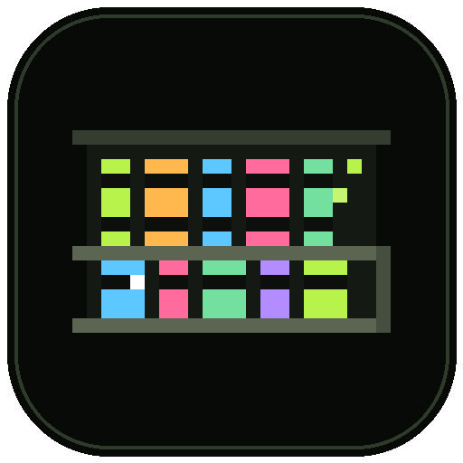
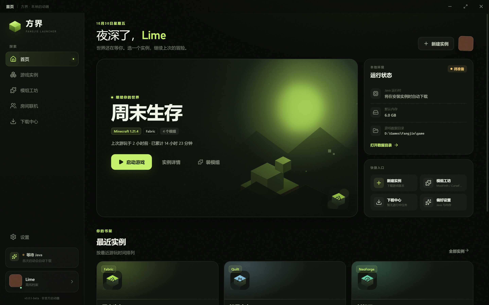
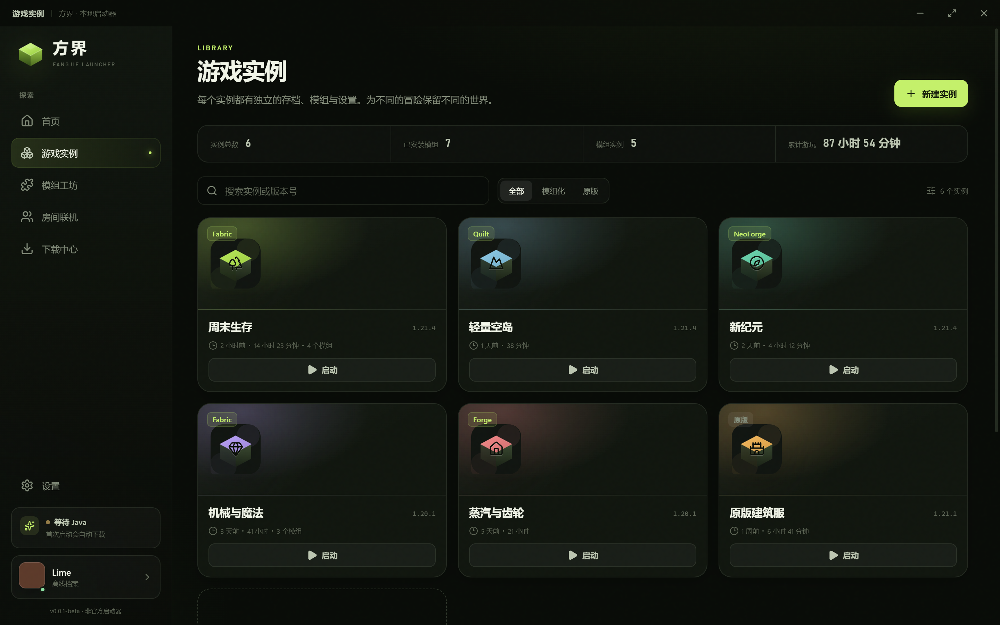
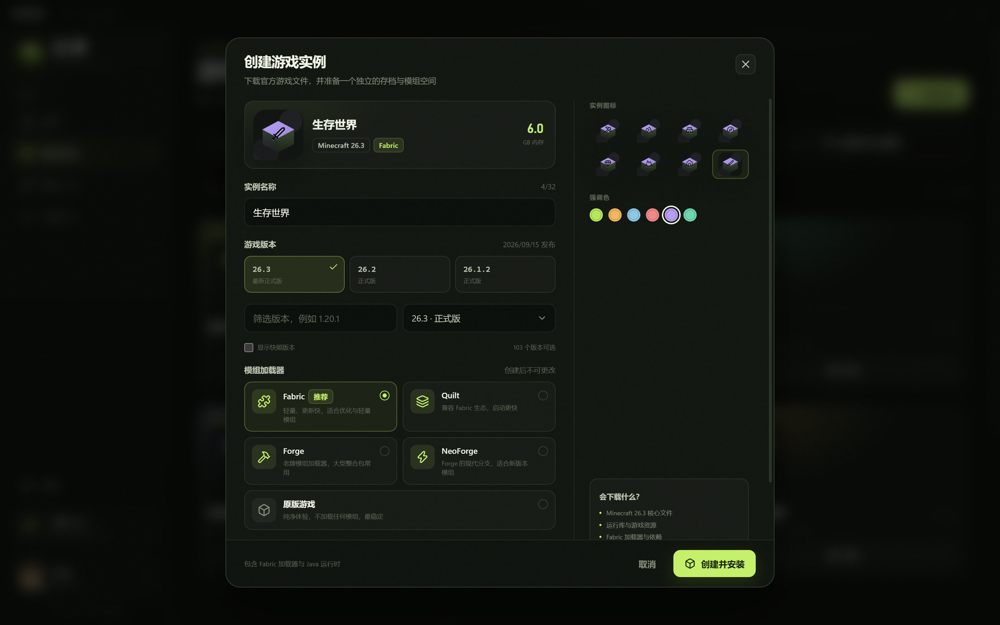
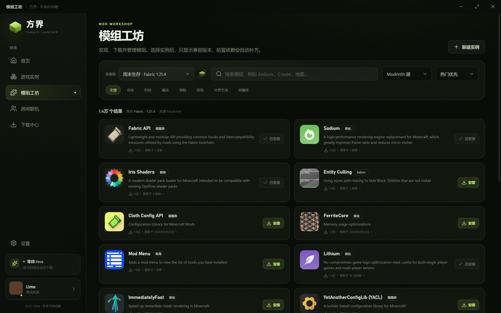
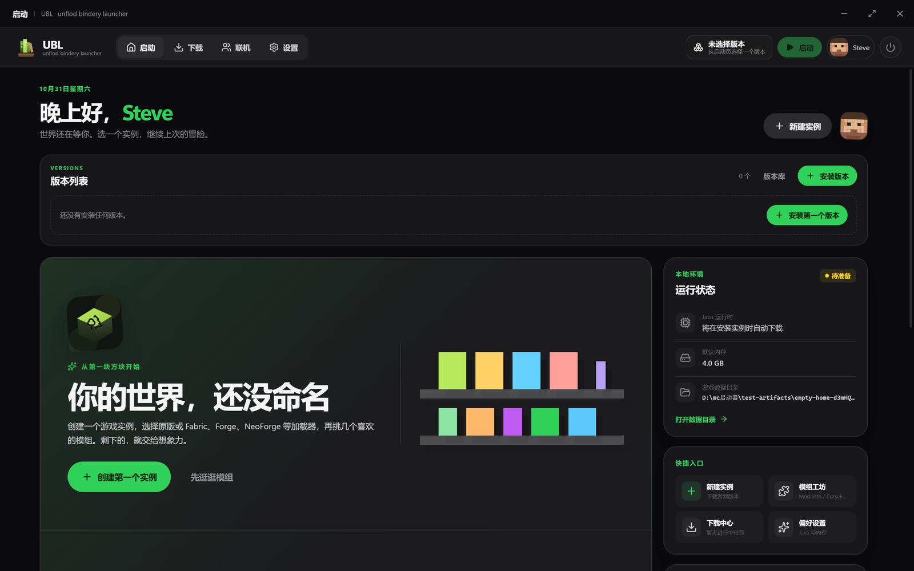
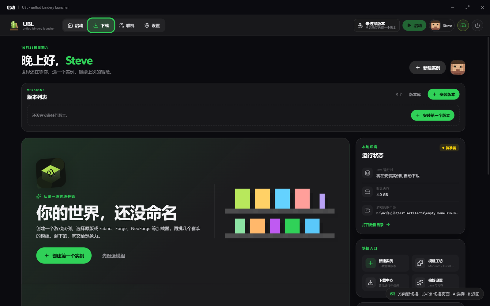
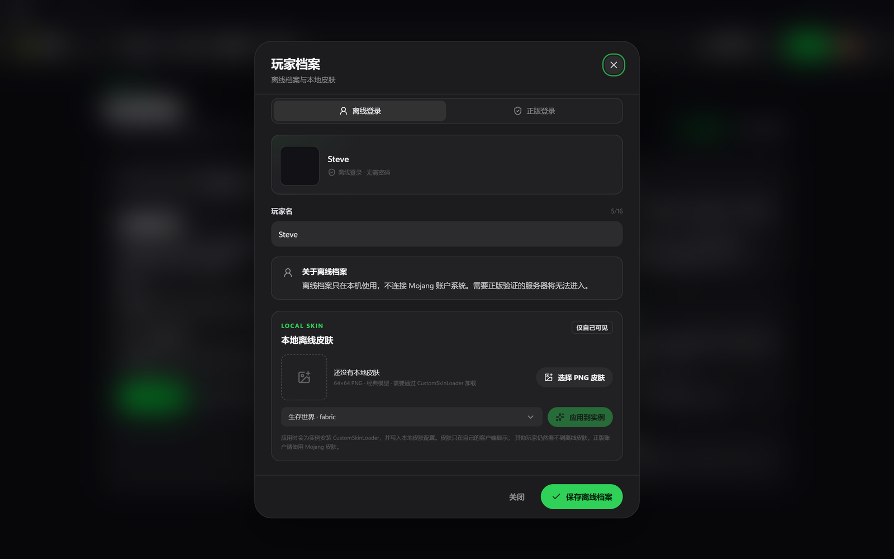
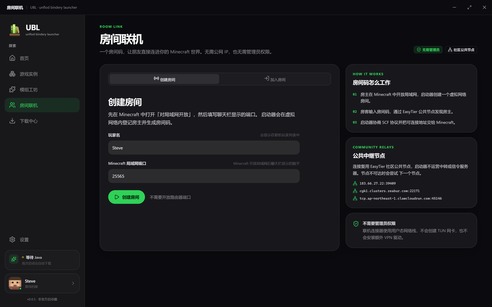

# unflod bindery launcher · UBL

官网：https://11ly322.github.io/fangjie-launcher/

[](https://github.com/11ly322/fangjie-launcher/releases)
[](LICENSE)


一个面向 Windows 的 Minecraft 桌面启动器，使用 Electron + React + TypeScript 构建。以游戏版本为中心组织启动、下载与实例管理：游戏实例、加载器安装、模组搜索下载、正版登录与离线皮肤。0.0.5 起更名为 **unflod bindery launcher（UBL）**，以书架和低 bit 像素为视觉主体。

> **0.0.13**：更新下载新增进度、45 秒无数据自动重试和浏览器下载兜底；不改变存档、实例或模组文件结构。
>
> 0.0.8 及更早版本的内置更新器仍有替换缺陷，请手动安装一次 0.0.9 或更新版本；0.0.9 起更新助手改用独立 PowerShell 流程，后续更新会写入安装目录并在完成后自动重启。



## 下载

从 [GitHub Releases](https://github.com/11ly322/fangjie-launcher/releases/tag/v0.0.13) 选择：

- `UBL-Launcher-0.0.13-Setup.exe`：Windows 安装包，按用户安装，无需管理员权限；会创建开始菜单项并注册卸载信息。
- `UBL-Portable-0.0.13.zip`：免安装便携版，解压后双击 `UBL.exe`。
- `SHA256SUMS.txt`：两个发布包的 SHA256 校验和。

系统要求：Windows 10/11 x64。首次创建实例会自动下载对应 Java 运行时；安装版默认安装到 `%LOCALAPPDATA%\Programs\UBL`，卸载不会删除游戏存档和用户数据。启动器继续复用 `%APPDATA%\fangjie-launcher` 数据目录，升级不会丢失旧实例。更新包与安装助手现在只写入安装目录下的 `updates/`，不再写入 `%APPDATA%\fangjie-launcher\updates`；不希望安装程序写卸载注册项时可直接使用便携版。

## 界面

| 首页 | 实例库 |
| --- | --- |
|  |  |

| 创建实例 | 模组工坊 |
| --- | --- |
|  |  |

| 空实例首页 | 手柄焦点 |
| --- | --- |
|  |  |

| 玩家档案 |
| --- |
|  |

| 房间联机 |
| --- |
|  |

## 当前能力

- **顶部工作台**：启动、下载、联机与设置集中在顶栏；启动页用横向版本列表选择实例，下载中心按内容类型组织入口，实例与模组列表支持自动刷新。
- **账号切换**：正版/离线入口可随时切换，已登录状态保留；可保存多个 Microsoft 账号并热切换，每个账号的令牌独立加密。
- **版本隔离**：设置中可选择关闭、隔离可安装 Mod 的版本、隔离非正式版、隔离可安装 Mod 的版本与非正式版或隔离所有版本；只影响新建实例。
- **手柄与退出**：支持空间焦点导航、长按方向键连续移动、LB/RB 切换主页面，A 确认，B 返回或关闭弹窗；连接手柄后顶栏显示状态，二级页面可返回上一级；顶栏提供退出启动器。
- **游戏实例**：为每个世界创建独立目录，存档、模组、配置与日志互不干扰。
- **多加载器**：原版、Fabric、Quilt、Forge、NeoForge。创建实例时先按所选 Minecraft 版本核验元数据，只展示真正有版本可下载的加载器；也可不建实例、单独把加载器装进共享版本目录。
- **实例加载器管理**：实例设置中可随时切换或移除模组加载器；切换前会核验该游戏版本可用的加载器，只更新实例的启动版本与加载器记录，不删除存档、配置或模组文件。
- **模组工坊**：支持 Modrinth 与 CurseForge 两个下载源；按实例加载器与游戏版本过滤，并可进一步筛选游戏版本、加载器与运行环境；游戏版本既可下拉，也可手动输入任意版本；内置离线中英词典，中文搜索词自动转换为英文关键词，结果标题/简介可自动显示中文；提供版本选择、必需前置索引与跳转、介绍页；已安装模组可直接切换版本并替换旧文件；资源包/光影同样支持双源。
- **独立下载**：模组详情可直接“仅下载文件”，不安装到实例；保存到数据目录的 `downloads/mods/`，并进入下载任务列表。
- **模组更新中心**：批量检查已安装模组的兼容更新，分组展示可更新/已是最新/不可自动更新；支持单个或全部更新、跳过版本、固定版本，更新前自动备份旧 JAR 并支持手动回滚。
- **世界快照**：手动或启动前自动快照存档、`options.txt`、`config/` 与模组清单；恢复前预览创建/覆盖项并自动生成安全快照；删除实例时可保留并归档快照。
- **性能基础**：每实例模组索引、首屏快照瘦身与按需详情加载、Modrinth/CurseForge 磁盘缓存、Java 检测缓存、下载任务事件合并。
- **整合包**：导入 `.mrpack` 或 CurseForge `.zip` 到现有实例；导出模组列表。
- **OptiFine**：选择官方 installer，无窗口调用本地安装接口并绑定生成的 profile。
- **网络设置**：HTTP(S) 代理、Modrinth/CurseForge API 基址；所有主进程 native fetch 走统一 seam。
- **插件与离线**：本地 manifest 校验、版本/权限展示；全局离线开关。
- **正版登录**：通过 Microsoft 官方登录窗口完成 Xbox Live 与 Minecraft 服务验证，可保存多个正版账号；每个账号的登录令牌使用 Electron `safeStorage` 加密保存，切换账号后仍可保留登录状态。
- **离线皮肤**：上传 64×64 PNG 皮肤，按实例安装 CustomSkinLoader 并写入本地皮肤配置。仅在自己的客户端显示。
- **房间联机（实验）**：房主生成 `U/XXXX-XXXX-XXXX-XXXX` 房间码，房客凭码加入并获得可直接粘贴进 Minecraft 的地址。EasyTier 以 Rust 库内嵌；不需要管理员权限、TUN 网卡或第三方 VPN。
- **故障诊断（P0）**：崩溃模式映射、JAR 依赖扫描、修复 diff 预览、逐文件备份与回滚；需要 `npm run build:core` 构建 Rust sidecar。
- **实例工具（P0）**：模组勾选批量启停、实例深复制、实例模板（JVM 参数/模组列表/内存/分辨率）。
- **软件更新（P1 基础）**：从 GitHub Releases 检查安装版更新；Node 证书库失败时自动使用 Electron Chromium 网络栈；下载后由 Rust 校验 SHA256，支持 NSIS 静默替换；真实签名安装包替换仍待实测。
- **Flight Recorder（P0）**：读取 `logs/flight-recorder.csv`，展示 FPS、1% lows、帧时间折线图并导出 CSV。
- **界面与主题**：0.0.5 重做为扁平、仿 iOS 的卡片界面，并以书架和低 bit 像素插画作为 UBL 的视觉主体；苔原、深海、余烬三套配色各自支持黑夜与白天模式，切换立即生效并写入本地配置。
- **可选数据目录**：设置中可把游戏数据迁移到任意空文件夹；完整复制后重启生效，旧目录保留，删除前可自行确认。
- **实用功能**：实例详情、模组启停/移除、下载中心、资源占用、启动日志、本地 Java 选择、自动 Java 下载。
- **房间联机**：首页房间快捷卡、房间码自动分段、联机状态/延迟与网络摘要。

## 从源码运行

环境要求：Windows 10/11 x64、Node.js 20.19+。

```powershell
npm install
npm run build:core   # 构建 Rust 崩溃诊断 / Flight Recorder sidecar
npm run dev
```

生产构建与便携包：

```powershell
npm run build
npm run package
```

默认生成免安装便携版到 `release/UBL-win32-x64/`，双击 `UBL.exe` 运行。

如需 NSIS 安装包：

```powershell
npm run package:installer
```

安装包输出到 `release/UBL-Launcher-0.0.13-Setup.exe`。

联机连接器不提交二进制，需先通过 `.github/workflows/connector-build.yml` 构建到 `resources/bin/qomicex-connector-cli.exe`；发布包中已包含该组件。构建脚本会查找 electron-builder 缓存或系统安装的 NSIS 3.x；也可用 `MAKENSIS` 环境变量指定 `makensis.exe`。安装包未做代码签名，Windows SmartScreen 可能提示未知发布者。

> 如果 Electron 二进制下载失败，可配置镜像后重新执行安装：
>
> ```powershell
> $env:ELECTRON_MIRROR = 'https://npmmirror.com/mirrors/electron/'
> node node_modules/electron/install.js
> ```
>
> 在某些自动化终端中可能存在 `ELECTRON_RUN_AS_NODE=1`，启动 Electron 前需要移除该环境变量，否则 Electron 会按 Node 进程运行。

## 数据位置

默认使用 Electron 的用户数据目录，游戏数据在其中的 `game/`：

- `game/minecraft/`：共享的游戏版本、资源、运行库与 Java。
- `game/instances/<id>/.minecraft/`：实例存档、模组、日志与配置。
- `config.json`：账户、实例元数据与启动器设置。
- `skins/`：本地皮肤 PNG。

可在「设置 → 存储位置」查看完整路径、直接打开目录，或点击「更改位置」迁移到新的空文件夹。迁移会完整复制游戏数据，旧目录不会删除；完成后需要重启启动器，路径记录在同目录的 `data-location.json`。

## 技术说明

- Minecraft 版本清单、游戏本体与资源来自 Mojang `piston-meta` / `piston-data`。
- Fabric 元数据走 [BMCLAPI](https://bmclapi2.bangbang93.com/) 镜像，避免官方 Meta 偶发挂起；Quilt 使用官方 Meta；Forge/NeoForge 使用 BMCLAPI 镜像版本列表。
- 模组搜索：Modrinth 官方 API；CurseForge 通过 [MCIM](https://mod.mcimirror.top/) 提供的公开镜像。
- 下载队列对 xmcl 的并发任务做了有界批处理，并为 HTTP 请求设置连接、首包与空闲超时，避免数千个资源同时打开导致进程资源耗尽。
- Forge / NeoForge 安装器与其前置库使用校验后的直连下载，避免镜像 HEAD 请求造成的长时间挂起。
- 正版登录使用 Microsoft OAuth 流程；令牌通过 Electron `safeStorage` 加密后写入本地配置。登录窗口由启动器打开，密码不会经过应用代码。
- 离线皮肤通过 [CustomSkinLoader](https://modrinth.com/mod/customskinloader) 的 `LocalSkin` 源实现。应用皮肤时会向实例写入该模组与配置。

## 已验证范围

在隔离的测试目录中实际跑通：

- Minecraft 1.21.4 原版文件、Java 21 自动下载、Fabric 0.20.1 安装。
- Fabric 实例安装 Sodium 并启动到客户端初始化，日志确认 Sodium 与 Fabric 依赖被加载。
- Quilt 0.30.1、Forge 54.1.22、NeoForge 21.4.161 的实例安装与启动到客户端初始化（纹理图集阶段）。
- CurseForge 源搜索与安装 Mouse Tweaks，自动补装 Fabric API；下载文件写入实例 `mods/`。
- CustomSkinLoader 安装、`CustomSkinLoader.json` 与 `LocalSkin/skins/<玩家名>.png` 写入。
- Microsoft 登录窗口打开、OAuth 取消后正确返回“已取消 Microsoft 登录”。
- 房间联机控制面：Host 生成房间码，Guest 通过公共中继加入，SCF 玩家列表显示双方，Guest 获得 `127.0.0.1:<port>` 地址。
- 房间联机数据面：同机经公共中继完成 Guest 转发端口到 Host 本地 TCP 服务的双向回显；真实跨机器 NAT 仍未验证。
- OptiFine 1.20.1 真实安装：官方 installer 无窗口桥接生成 `1.20.1-OptiFine_HD_U_I6` 并回写实例。

## 已知限制

- 崩溃诊断/Flight Recorder 依赖 `resources/bin/fangjie-core-sidecar.exe`；开发构建需先 `npm run build:core`。
- Flight Recorder 目前是 CSV 读取与可视化，尚未内置游戏内采样器。

- 仅面向 Windows，尚未适配 macOS/Linux。
- 正版登录的“完成授权并在线启动”未使用真实 Microsoft 账号做端到端测试；请使用自己的账号验证。未成年人 Xbox 家庭组账号需要成年人授权。
- 本地皮肤只在自己客户端显示，其他玩家看不到离线皮肤；仅支持经典（wide）模型。实际皮肤显示效果取决于 CustomSkinLoader 与游戏版本。
- 整合包支持 `.mrpack` 与 CurseForge `.zip` 基础导入，但复杂整合包/真实文件下载仍需更多回归；CurseForge 私有项目 API Key 未实现。
- 资源包/光影已支持 Modrinth 与 CurseForge 搜索；OptiFine 需要用户提供官方 installer 和本机 Java，启动器调用其本地安装接口，无需在窗口中点击。
- 皮肤 3D 预览未实现。
- 网络设置已支持代理和 Modrinth/CurseForge 基址，但 Mojang/Java/Microsoft 等全部路径尚未迁移到统一下载源。
- CurseForge 依赖 MCIM 公开镜像，若镜像不可用可切换回 Modrinth。
- Forge / NeoForge 的安装需要联网下载较大的安装器与前置；首次安装会比 Fabric 慢。
- 房间联机的 P2P 数据面在真实跨机器 NAT 环境尚未完整验证；本版验证了公共中继下的 Host/Guest 控制面与端口映射。
- 连接器是 GPL-3.0-or-later 独立组件；启动器主体仍为 MIT。
- 自动更新器已有检查/下载/SHA256/NSIS 入口，但未用真实签名安装包验证；当前发布包仍未签名。

## 开发与测试

```powershell
npm run typecheck   # 主进程 + 渲染进程类型检查
npm test            # 工具函数测试
npm run build       # 构建生产包
```

验证脚本（会在工作区 `test-artifacts/` 下生成隔离数据，不会修改真实配置）：

```powershell
node scripts/visual-check.cjs       # 界面截图
node scripts/e2e-check.cjs          # 真实安装 / 模组 / 启动测试
node scripts/loader-launch-check.cjs # 多加载器启动测试
```

## Rust 核心（实验）

`rust/fangjie-core` 是面向 Tauri v2 的独立 Rust 核心，包含崩溃诊断、JAR 扫描、diff 预览/回滚、下载源抽象、实例复制/模板、Flight Recorder 与插件接口。它已经通过 `cargo test` 与 `cargo check --features tauri`，但**尚未接入当前 Electron UI**。详见 [rust/README.md](rust/README.md)。

## 开源

- 许可证：[MIT](LICENSE)
- 参与贡献：[CONTRIBUTING.md](CONTRIBUTING.md)
- 安全问题：[SECURITY.md](SECURITY.md)
- 更新记录：[CHANGELOG.md](CHANGELOG.md)
- 联机实现说明：[docs/multiplayer.md](docs/multiplayer.md)
- 代码签名：[docs/code-signing.md](docs/code-signing.md)（CI 需 `WINDOWS_CERT_PFX_BASE64` / `WINDOWS_CERT_PASSWORD`）
- 跨机器 NAT 验证：[docs/nat-test-matrix.md](docs/nat-test-matrix.md)
- CI：推送 `v*` 标签会构建 Windows 便携包与 NSIS 安装包，并上传为 Actions artifact；维护者从 artifact 发布 GitHub Release

本项目为非官方启动器，与 Mojang Studios、Microsoft、Modrinth、CurseForge 无隶属关系。Minecraft 相关版权归其各自所有者所有。
