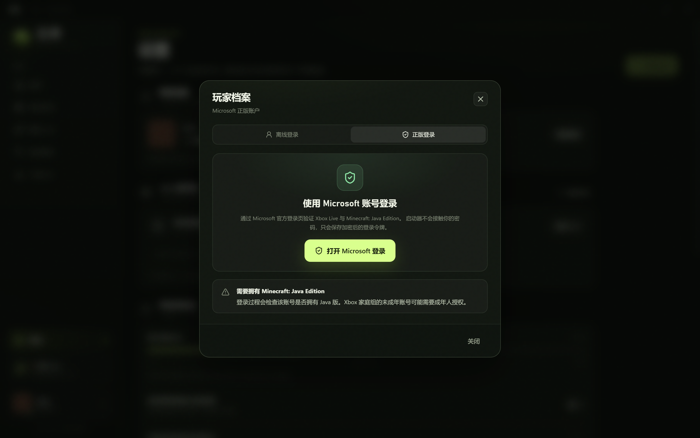

# 方界启动器 · Fangjie Launcher

[](https://github.com/11ly322/fangjie-launcher/releases)
[](LICENSE)


一个面向 Windows 的 Minecraft 桌面启动器，使用 Electron + React + TypeScript 构建。目标是接近 PCL2 的核心使用体验：游戏实例、加载器安装、模组搜索下载、正版登录与离线皮肤。

> **0.0.1-beta**：新增房间码联机。主流程与联机控制面已实测，P2P 数据面仍需真实跨机器网络验证；请先备份重要存档。


## 下载

从 [GitHub Releases](https://github.com/11ly322/fangjie-launcher/releases/tag/v0.0.1-beta) 选择：

- `Fangjie-Launcher-0.0.1-beta-Setup.exe`：Windows 安装包，按用户安装，无需管理员权限；会创建桌面与开始菜单快捷方式，并注册卸载项。
- `Fangjie-Portable-0.0.1-beta.zip`：免安装便携版，解压后双击 `Fangjie.exe`。
- `SHA256SUMS.txt`：两个发布包的 SHA256 校验和。

系统要求：Windows 10/11 x64。首次创建实例会自动下载对应 Java 运行时；安装版默认安装到 `%LOCALAPPDATA%\Programs\Fangjie Launcher`，卸载不会删除游戏存档和用户数据。

## 界面

| 首页 | 实例库 |
| --- | --- |
|  |  |

| 创建实例 | 模组工坊 |
| --- | --- |
|  |  |

| 本地皮肤 | 正版登录 |
| --- | --- |
|  |  |

| 房间联机 |
| --- |
|  |

## 当前能力

- **游戏实例**：为每个世界创建独立目录，存档、模组、配置与日志互不干扰。
- **多加载器**：原版、Fabric、Quilt、Forge、NeoForge。安装时自动准备 Java 运行时。
- **模组工坊**：支持 Modrinth 与 CurseForge 两个下载源；按实例加载器与游戏版本过滤；自动安装必需前置。
- **正版登录**：通过 Microsoft 官方登录窗口完成 Xbox Live 与 Minecraft 服务验证，登录令牌使用 Electron `safeStorage` 加密保存；刷新令牌可维持登录状态。
- **离线皮肤**：上传 64×64 PNG 皮肤，按实例安装 CustomSkinLoader 并写入本地皮肤配置。仅在自己的客户端显示。
- **房间联机（实验）**：房主生成 `U/XXXX-XXXX-XXXX-XXXX` 房间码，房客凭码加入并获得可直接粘贴进 Minecraft 的地址。EasyTier 以 Rust 库内嵌；不需要管理员权限、TUN 网卡或第三方 VPN。
- **实用功能**：实例详情、模组启停/移除、下载中心、资源占用、启动日志、本地 Java 选择、自动 Java 下载。

## 从源码运行

环境要求：Windows 10/11 x64、Node.js 20.19+。

```powershell
npm install
npm run dev
```

生产构建与便携包：

```powershell
npm run build
npm run package
```

默认生成免安装便携版到 `release/Fangjie-win32-x64/`，双击 `Fangjie.exe` 运行。

如需 NSIS 安装包：

```powershell
npm run package:installer
```

安装包输出到 `release/Fangjie-Launcher-0.0.1-beta-Setup.exe`。

联机连接器不提交二进制，需先通过 `.github/workflows/connector-build.yml` 构建到 `resources/bin/qomicex-connector-cli.exe`；发布包中已包含该组件。构建脚本会查找 electron-builder 缓存或系统安装的 NSIS 3.x；也可用 `MAKENSIS` 环境变量指定 `makensis.exe`。安装包未做代码签名，Windows SmartScreen 可能提示未知发布者。

> 如果 Electron 二进制下载失败，可配置镜像后重新执行安装：
>
> ```powershell
> $env:ELECTRON_MIRROR = 'https://npmmirror.com/mirrors/electron/'
> node node_modules/electron/install.js
> ```
>
> 在某些自动化终端中可能存在 `ELECTRON_RUN_AS_NODE=1`，启动 Electron 前需要移除该环境变量，否则 Electron 会按 Node 进程运行。

## 数据位置

默认使用 Electron 的用户数据目录，游戏数据在其中的 `game/`：

- `game/minecraft/`：共享的游戏版本、资源、运行库与 Java。
- `game/instances/<id>/.minecraft/`：实例存档、模组、日志与配置。
- `config.json`：账户、实例元数据与启动器设置。
- `skins/`：本地皮肤 PNG。

可在「设置」中查看完整路径并直接打开目录。

## 技术说明

- Minecraft 版本清单、游戏本体与资源来自 Mojang `piston-meta` / `piston-data`。
- Fabric 元数据走 [BMCLAPI](https://bmclapi2.bangbang93.com/) 镜像，避免官方 Meta 偶发挂起；Quilt 使用官方 Meta；Forge/NeoForge 使用 BMCLAPI 镜像版本列表。
- 模组搜索：Modrinth 官方 API；CurseForge 通过 [MCIM](https://mod.mcimirror.top/) 提供的公开镜像。
- 下载队列对 xmcl 的并发任务做了有界批处理，并为 HTTP 请求设置连接、首包与空闲超时，避免数千个资源同时打开导致进程资源耗尽。
- Forge / NeoForge 安装器与其前置库使用校验后的直连下载，避免镜像 HEAD 请求造成的长时间挂起。
- 正版登录使用 Microsoft OAuth 流程；令牌通过 Electron `safeStorage` 加密后写入本地配置。登录窗口由启动器打开，密码不会经过应用代码。
- 离线皮肤通过 [CustomSkinLoader](https://modrinth.com/mod/customskinloader) 的 `LocalSkin` 源实现。应用皮肤时会向实例写入该模组与配置。

## 已验证范围

在隔离的测试目录中实际跑通：

- Minecraft 1.21.4 原版文件、Java 21 自动下载、Fabric 0.20.1 安装。
- Fabric 实例安装 Sodium 并启动到客户端初始化，日志确认 Sodium 与 Fabric 依赖被加载。
- Quilt 0.30.1、Forge 54.1.22、NeoForge 21.4.161 的实例安装与启动到客户端初始化（纹理图集阶段）。
- CurseForge 源搜索与安装 Mouse Tweaks，自动补装 Fabric API；下载文件写入实例 `mods/`。
- CustomSkinLoader 安装、`CustomSkinLoader.json` 与 `LocalSkin/skins/<玩家名>.png` 写入。
- Microsoft 登录窗口打开、OAuth 取消后正确返回“已取消 Microsoft 登录”。
- 房间联机控制面：Host 生成房间码，Guest 通过公共中继加入，SCF 玩家列表显示双方，Guest 获得 `127.0.0.1:<port>` 地址。
- 房间联机数据面：同机经公共中继完成 Guest 转发端口到 Host 本地 TCP 服务的双向回显；真实跨机器 NAT 仍未验证。

## 已知限制

- 仅面向 Windows，尚未适配 macOS/Linux。
- 正版登录的“完成授权并在线启动”未使用真实 Microsoft 账号做端到端测试；请使用自己的账号验证。未成年人 Xbox 家庭组账号需要成年人授权。
- 本地皮肤只在自己客户端显示，其他玩家看不到离线皮肤；仅支持经典（wide）模型。实际皮肤显示效果取决于 CustomSkinLoader 与游戏版本。
- 暂不支持整合包（Modpack）、资源包/光影下载、OptiFine 自动安装、皮肤 3D 预览与 CurseForge 账户 API Key 私有项目。
- CurseForge 依赖 MCIM 公开镜像，若镜像不可用可切换回 Modrinth。
- Forge / NeoForge 的安装需要联网下载较大的安装器与前置；首次安装会比 Fabric 慢。
- 房间联机的 P2P 数据面在真实跨机器 NAT 环境尚未完整验证；本版验证了公共中继下的 Host/Guest 控制面与端口映射。
- 连接器是 GPL-3.0-or-later 独立组件；启动器主体仍为 MIT。
- 0.0.1-beta 提供便携版与安装版，但尚未提供自动更新器；安装包未签名。

## 开发与测试

```powershell
npm run typecheck   # 主进程 + 渲染进程类型检查
npm test            # 工具函数测试
npm run build       # 构建生产包
```

验证脚本（会在工作区 `test-artifacts/` 下生成隔离数据，不会修改真实配置）：

```powershell
node scripts/visual-check.cjs       # 界面截图
node scripts/e2e-check.cjs          # 真实安装 / 模组 / 启动测试
node scripts/loader-launch-check.cjs # 多加载器启动测试
```

## 开源

- 许可证：[MIT](LICENSE)
- 参与贡献：[CONTRIBUTING.md](CONTRIBUTING.md)
- 安全问题：[SECURITY.md](SECURITY.md)
- 更新记录：[CHANGELOG.md](CHANGELOG.md)
- 联机实现说明：[docs/multiplayer.md](docs/multiplayer.md)
- CI：推送 `v*` 标签会构建 Windows 便携包与 NSIS 安装包，并上传为 Actions artifact；维护者从 artifact 发布 GitHub Release

本项目为非官方启动器，与 Mojang Studios、Microsoft、Modrinth、CurseForge 无隶属关系。Minecraft 相关版权归其各自所有者所有。
